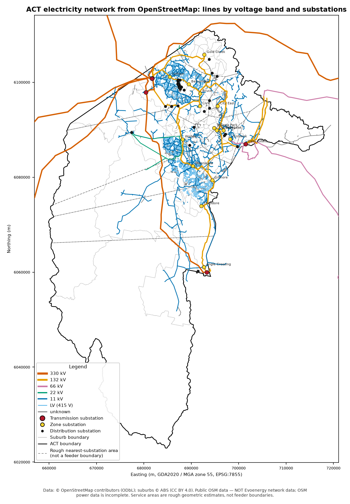
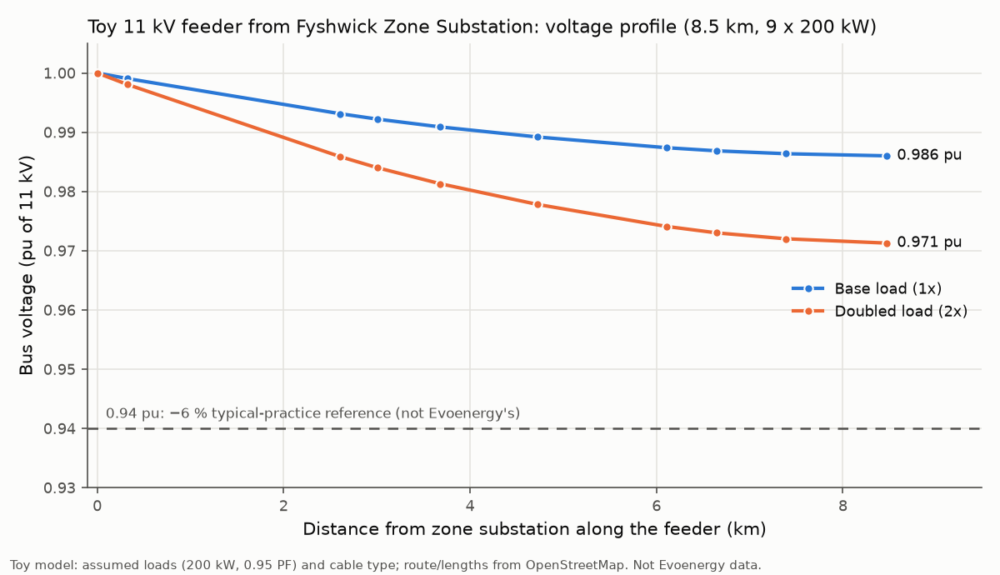

# ACT Electricity Network Explorer

This project maps the ACT's electricity network from public OpenStreetMap data, using open-source GIS tools. It uses Python (GeoPandas, shapely, networkx, folium) and QGIS for viewing. It checks the network for connectivity and data-quality problems, estimates rough nearest-substation areas, and runs a toy pandapower load flow on one 11 kV path. It was built as a self-directed project to learn how GIS is used to manage an electricity distribution network.

**This uses public OpenStreetMap data. It is not Evoenergy's network data, and OSM power data is incomplete.**

## Screenshots





The interactive map is `outputs/map.html`. Open it in a browser. It needs internet access to load the base map tiles.

## What it finds

All figures come from [outputs/summary.md](outputs/summary.md), which `python -m act_network.build` writes.

Line length inside the ACT (6,804 mapped segments):

| Measure | km inside the ACT |
|---|---:|
| Total | 1,817.7 |
| Transmission (66 kV and above) | 384.2 |
| Distribution (under 66 kV) | 1,286.3 |
| 11 kV | 635.7 |
| LV (415 V) | 617.6 |
| No voltage tag | 147.3 |

Of the total, 14.3 km is underground.

Substations and flagged issues:

| Measure | Value |
|---|---:|
| OSM substation features | 59 (17 zone) |
| Distinct zone substation sites | 16 |
| Rows flagged by the checks: likely error | 29 (22 inside substation sites, 7 elsewhere) |
| Rows flagged by the checks: to check | 5,389 |
| Rows flagged by the checks: tag gap | 626 |

The row count is not an error count. Most "to check" rows are dangling line ends and disconnected sections, which may partly reflect incomplete OSM mapping. None of the flagged items has been verified against the real network.

Top 3 furthest suburbs from the nearest zone substation (straight-line distance):

| # | Suburb | Distance (km) | Nearest zone substation |
|---|---|---:|---|
| 1 | Uriarra Village | 13.6 | Latham Zone Substation |
| 2 | Tharwa | 7.4 | Theodore Zone Substation |
| 3 | Whitlam | 6.9 | Civic Zone Substation |

What the checks show, from [outputs/quality_report.md](outputs/quality_report.md) and the feeder results:

- Most dangling ends are normal radial feeder ends or unmapped equipment. A radial LV or 11 kV feeder legitimately ends at its last pole.
- Only 2 of 17 zone-substation features touch an 11 kV-tagged line, so the toy feeder choice was narrow.
- 22 of the 29 rows in the likely-error group are overlapping conductors inside substation sites, mostly `line=bay` and `line=busbar` ways that look mapped twice.
- 626 ways have no voltage tag. Lines with no voltage tag are excluded from the voltage-based feeder selection.
- Most floating sections (764 flagged) are distribution or unknown-voltage pieces with no substation mapped. OSM rarely maps 11 kV underground cables, so these usually mean incomplete mapping.

Full detail is in [outputs/summary.md](outputs/summary.md) and [outputs/quality_report.md](outputs/quality_report.md).

## How to run

Requires Python 3.11 or newer.

With uv:

```sh
uv venv --python 3.13 .venv
uv pip install -e ".[dev]"
source .venv/bin/activate
```

With the standard library:

```sh
python -m venv .venv
source .venv/bin/activate
pip install -e ".[dev]"
```

Then:

- `python -m act_network.fetch` downloads OSM and ABS data. The small cached inputs in `data/raw/` are committed, so this skips them. Use `--force` to re-download. The ABS zip (about 104 MB) is not committed, so a fresh clone downloads it.
- `python -m act_network.build` runs the pipeline: clean → report → service_areas → feeder → webmap → static_map → summary. It does not fetch data. It needs the raw files in `data/raw/`.
- `pytest` runs the offline tests on synthetic data.

Modules in `src/act_network/`:

| Module | What it does |
|---|---|
| `fetch.py` | Downloads and caches OSM and ABS data into `data/raw/`. |
| `clean.py` | Cleans the raw OSM and ABS data into `data/processed/act_power.gpkg`. |
| `topology.py` | Builds a connectivity graph of the OSM power network. |
| `report.py` | Writes the data-quality report (CSV, Markdown and GeoPackage). |
| `service_areas.py` | Builds rough nearest-substation areas (Voronoi) and suburb-to-substation distances. |
| `feeder.py` | Builds a toy radial 11 kV feeder from OSM segment lengths and runs a pandapower load flow. |
| `webmap.py` | Builds the interactive folium map, `outputs/map.html`. |
| `static_map.py` | Builds the static matplotlib map, `outputs/map.png`. |
| `build.py` | Runs the whole pipeline and writes `outputs/summary.md`. |

## Development

```sh
uv venv                        # only needed on a fresh checkout
uv pip install -e '.[dev]'
nvim .
```

The Neovim setup on this machine finds `.venv` automatically; activation is optional.
See [the Neovim guide](docs/nvim.md) for navigation, windows, linting, and shortcuts.

```sh
.venv/bin/pytest -q
.venv/bin/ruff check .          # lint
.venv/bin/ruff format --check . # check formatting
.venv/bin/basedpyright         # type check
```

Existing code may have lint, formatting, and type findings. Use the editor's
diagnostics to address them as you work; these commands do not change files.

## Method notes

- CRS: EPSG:7855 (GDA2020 / MGA zone 55) for distances and areas; EPSG:4326 (WGS84) for raw data.
- Snapping: line endpoints within 5 m are joined, including T-junctions. Transmission and distribution lines are not snapped to each other.
- Substation connection: a line endpoint inside a substation footprint, or within 30 m of its point, counts as connected.
- Zone substations are chosen by voltage (≥66 kV stepping down to <66 kV), because OSM's `substation=` tag is unreliable.
- Lengths are clipped to the ACT boundary.

## Toy model: assumed loads and cable type; not a real Evoenergy feeder study

The model starts at Fyshwick Zone Substation and follows the longest 11 kV path through the OSM data. That path is 8.47 km long. Only the trunk is modelled, so branches are ignored. The route and section lengths come from OSM. Every electrical value is assumed: a 1.00 pu ideal source, nine 200 kW loads at 0.95 power factor, and one standard pandapower cable type. The model runs `pp.runpp` and reports the end-of-feeder voltage and line loading, at base load and with the load doubled.

Assumptions (copied from [outputs/feeder_results.md](outputs/feeder_results.md)):

| # | Assumption | Value | Basis / caveat |
|---:|---|---|---|
| 1 | Model status | Toy model | Assumed loads and cable type; not an Evoenergy feeder study and not Evoenergy data. |
| 2 | Route and section lengths | OpenStreetMap 11 kV ways | Lengths measured on the OSM geometry in GDA2020 / MGA zone 55 (EPSG:7855). OSM is incomplete and may not match the real feeder route or switching. |
| 3 | Path selection rule | Longest shortest 11 kV path from a zone substation | From each zone substation, follow only line edges whose voltage tag includes 11000 V (other substations are barriers); take the node with the longest shortest-path distance (by GIS length) from the substation; across substations keep the longest (ties: smaller node id / substation OSM id). |
| 4 | Section merging | sections < 200 m merged | Very short OSM sections joined to the previous one (first one to the next) so the model has a readable number of buses. Total length unchanged. |
| 5 | Trunk only | branches ignored | Branches leaving the path and their load are not modelled, so real trunk current would be higher than shown. |
| 6 | Source | ext_grid, 1.00 pu at the zone substation 11 kV bus | Assumed stiff source at nominal voltage. Real zone substations regulate the 11 kV bus with tap changers, often above 1.00 pu. |
| 7 | Transformer | not modelled | No 132(66)/11 kV zone transformer and no 11 kV/415 V distribution transformers; loads sit directly on 11 kV buses. |
| 8 | Nominal voltage | 11 kV | From the OSM voltage tag. |
| 9 | Conductor | NA2XS2Y 1x185 RM/25 12/20 kV (all sections) | pandapower standard type (r = 0.161 Ω/km, x = 0.117 Ω/km, c = 273 nF/km, rating 362 A). Chosen because the project brief suggests it and it ships with pandapower: a common European 185 mm² Al XLPE 12/20 kV cable. Most of this OSM path is overhead (power=line/minor_line, one short power=cable section) and real ACT 11 kV conductors differ; overhead lines have higher reactance, lower capacitance and different ratings. |
| 10 | Load size | 200 kW per load | Assumed round number, not measured demand. |
| 11 | Power factor | 0.95 lagging (65.7 kvar per load) | Assumed. |
| 12 | Load placement | one load at every bus except the source (9 loads) | Assumed: one load at the far end of each (merged) section. |
| 13 | Load model | constant power (PQ), balanced 3-phase | Positive-sequence load flow (pp.runpp, Newton-Raphson); no unbalance, no voltage dependence. |
| 14 | Doubled-load case | all loads x2 | Uniform scaling of every load. |
| 15 | Voltage planning reference | ±6 % (0.94–1.06 pu) | Typical-practice reference only, not Evoenergy's standard. In practice the 11 kV network gets only part of the end-to-end voltage budget (the LV network and distribution transformer also drop voltage). |
| 16 | Thermal reference | 100 % of the std-type max_i_ka | pandapower's rating for that cable under its reference installation conditions; no derating. |

Results (toy model):

| Metric | Base (1x) | Doubled (2x) |
|---|---:|---:|
| Total load | 1800 kW / 592 kvar | 3600 kW / 1183 kvar |
| End-of-feeder voltage | 0.9860 pu | 0.9713 pu |
| End-of-feeder voltage drop | 1.40 % | 2.87 % |
| Minimum bus voltage | 0.9860 pu (bus 9) | 0.9713 pu (bus 9) |
| Max line loading | 27.4 % (section 1, 99 A) | 55.7 % (section 1, 202 A) |
| Total line losses | 16.1 kW | 66.8 kW |
| Within ±6 % reference? | yes | yes |
| Within thermal reference? | yes | yes |

Load growth (uniform scaling of all loads): the minimum voltage first falls below 0.94 pu at about 4.03x the base load. The most loaded section first exceeds 100 % of its cable rating at about 3.52x. The binding limit in this toy model is thermal.

## Limitations

- OSM gaps and inconsistent tagging. 147.3 km of line inside the ACT has no voltage tag, and 626 ways have no voltage tag. Many underground 11 kV cables, transformers and service lines are not mapped, so absence in OSM is not absence on the ground.
- Snapping tolerance sensitivity. With the 5 m tolerance there are 764 floating components. At 2 m there are 769 and at 10 m there are 746.
- The rough nearest-substation areas (Voronoi) are not feeder boundaries.
- OSM substation features are not the same as sites. There are 59 features, of which 17 are zone features that make up 16 distinct sites.
- The toy feeder ignores branches and uses an underground cable type (NA2XS2Y) on a mostly overhead route.
- Not ArcFM: this is open-source GIS. ArcFM is a licensed Schneider Electric product and was not used.
- The QGIS map is a manual step. `outputs/map.png` is a matplotlib stand-in.

## Data sources and licences

- © OpenStreetMap contributors, ODbL 1.0 (https://www.openstreetmap.org/copyright). The committed OSM extracts in `data/raw/` (`act_boundary.gpkg`, `osm_power_network.gpkg`, `osm_power_supports.gpkg`) are derived from OSM and remain under ODbL.
- ABS ASGS Edition 3 (2021) Suburbs and Localities, CC BY 4.0. The source URL is in `src/act_network/fetch.py`: `https://www.abs.gov.au/statistics/standards/australian-statistical-geography-standard-asgs/edition-3-july-2021-june-2026/access-and-downloads/digital-boundary-files/SAL_2021_AUST_GDA2020_SHP.zip`. `act_suburbs.gpkg` is derived from this data.
- Map tiles © OpenStreetMap.

## CI

Tests run on GitHub Actions on Python 3.11 and 3.13 (`.github/workflows/tests.yml`).
