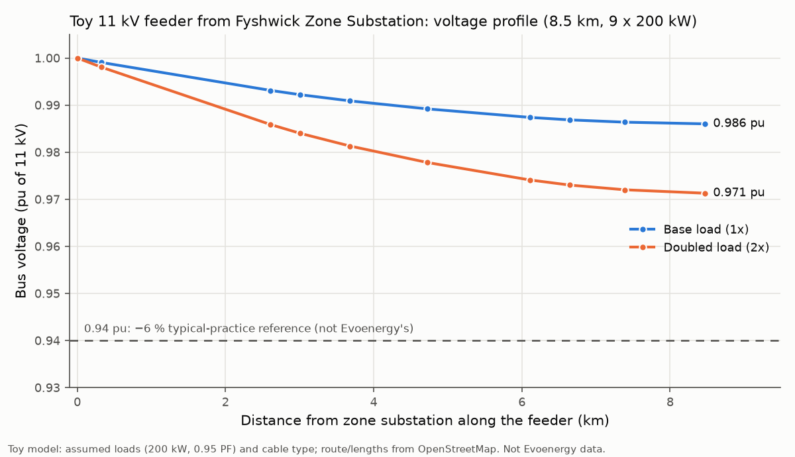

# Toy 11 kV feeder load flow (pandapower)

> **Toy model — assumed loads and cable type; not a real Evoenergy feeder study.**
> Route and section lengths come from public OpenStreetMap data (© OpenStreetMap contributors, ODbL); everything electrical is assumed.

## Chosen path

- **Source:** Fyshwick Zone Substation (OSM 344074567, tagged voltages 66000;11000)
- **Rule:** From each zone substation, follow only line edges whose voltage tag includes 11000 V (other substations are barriers); take the node with the longest shortest-path distance (by GIS length) from the substation; across substations keep the longest (ties: smaller node id / substation OSM id).
- Only 2 of 17 zone-substation features in the graph touch any edge tagged 11 kV, so the choice was narrow. This counts only voltage-tagged edges: 626 lines with no voltage tag are excluded and some of them are probably 11 kV (an OSM data-coverage finding).
- **Length:** 8.47 km over 13 OSM sections on 6 OSM ways, merged into 9 model sections (10 buses).
- **OSM way ids (substation → end):** 1290585238, 1290585239, 785063811, 785063816, 782997752, 782976036
- 8 nodes along the path have 11 kV branches that the model ignores (trunk only): the modelled trunk is 8.47 km of the 14.73 km of 11 kV-tagged line reachable from the substation in the graph.

| Model section | From bus → to bus | Length (m) | OSM way ids | OSM power tag |
|---|---|---:|---|---|
| 1 | 0 → 1 | 326 | 1290585238, 1290585239 | minor_line, cable |
| 2 | 1 → 2 | 2283 | 785063811 | minor_line |
| 3 | 2 → 3 | 396 | 785063811 | minor_line |
| 4 | 3 → 4 | 677 | 785063816 | line |
| 5 | 4 → 5 | 1043 | 785063816 | line |
| 6 | 5 → 6 | 1383 | 785063816 | line |
| 7 | 6 → 7 | 541 | 785063816 | line |
| 8 | 7 → 8 | 741 | 782997752 | line |
| 9 | 8 → 9 | 1078 | 782976036 | minor_line |

## Assumptions

| # | Assumption | Value | Basis / caveat |
|---:|---|---|---|
| 1 | Model status | Toy model | Assumed loads and cable type; not an Evoenergy feeder study and not Evoenergy data. |
| 2 | Route and section lengths | OpenStreetMap 11 kV ways | Lengths measured on the OSM geometry in GDA2020 / MGA zone 55 (EPSG:7855). OSM is incomplete and may not match the real feeder route or switching. |
| 3 | Path selection rule | Longest shortest 11 kV path from a zone substation | From each zone substation, follow only line edges whose voltage tag includes 11000 V (other substations are barriers); take the node with the longest shortest-path distance (by GIS length) from the substation; across substations keep the longest (ties: smaller node id / substation OSM id). |
| 4 | Section merging | sections < 200 m merged | Very short OSM sections joined to the previous one (first one to the next) so the model has a readable number of buses. Total length unchanged. |
| 5 | Trunk only | branches ignored | Branches leaving the path and their load are not modelled, so real trunk current would be higher than shown. |
| 6 | Source | ext_grid, 1.00 pu at the zone substation 11 kV bus | Assumed stiff source at nominal voltage. Real zone substations regulate the 11 kV bus with tap changers, often above 1.00 pu. |
| 7 | Transformer | not modelled | No 132(66)/11 kV zone transformer and no 11 kV/415 V distribution transformers; loads sit directly on 11 kV buses. |
| 8 | Nominal voltage | 11 kV | From the OSM voltage tag. |
| 9 | Conductor | NA2XS2Y 1x185 RM/25 12/20 kV (all sections) | pandapower standard type (r = 0.161 Ω/km, x = 0.117 Ω/km, c = 273 nF/km, rating 362 A). Chosen because the project brief suggests it and it ships with pandapower: a common European 185 mm² Al XLPE 12/20 kV cable. Most of this OSM path is overhead (power=line/minor_line, one short power=cable section) and real ACT 11 kV conductors differ; overhead lines have higher reactance, lower capacitance and different ratings. |
| 10 | Load size | 200 kW per load | Assumed round number, not measured demand. |
| 11 | Power factor | 0.95 lagging (65.7 kvar per load) | Assumed. |
| 12 | Load placement | one load at every bus except the source (9 loads) | Assumed: one load at the far end of each (merged) section. |
| 13 | Load model | constant power (PQ), balanced 3-phase | Positive-sequence load flow (pp.runpp, Newton-Raphson); no unbalance, no voltage dependence. |
| 14 | Doubled-load case | all loads x2 | Uniform scaling of every load. |
| 15 | Voltage planning reference | ±6 % (0.94–1.06 pu) | Typical-practice reference only, not Evoenergy's standard. In practice the 11 kV network gets only part of the end-to-end voltage budget (the LV network and distribution transformer also drop voltage). |
| 16 | Thermal reference | 100 % of the std-type max_i_ka | pandapower's rating for that cable under its reference installation conditions; no derating. |

## Results

| Metric | Base (1x) | Doubled (2x) |
|---|---:|---:|
| Total load | 1800 kW / 592 kvar | 3600 kW / 1183 kvar |
| End-of-feeder voltage | 0.9860 pu | 0.9713 pu |
| End-of-feeder voltage drop | 1.40 % | 2.87 % |
| Minimum bus voltage | 0.9860 pu (bus 9) | 0.9713 pu (bus 9) |
| Max line loading | 27.4 % (section 1, 99 A) | 55.7 % (section 1, 202 A) |
| Total line losses | 16.1 kW | 66.8 kW |
| Within ±6 % reference? | yes | yes |
| Within thermal reference? | yes | yes |

### How far could load grow (uniform scaling of all loads)?

- Minimum voltage first falls below 0.94 pu at about **4.03x** the base load.
- The most loaded section first exceeds 100 % of the cable rating at about **3.52x** the base load.
- Binding limit in this toy model: **thermal (loading > 100 % of cable rating)**.

## Reading these numbers

- The voltages and loadings are what this assumed model gives, not measurements of the real feeder.
- Loads, power factor, cable type and source voltage are assumptions; change any of them and the numbers change. Only the route and section lengths come from data (OSM, which is incomplete).
- Branch load is ignored, so real trunk current and voltage drop would be higher for the same per-bus load.

Regenerate with `python -m act_network.feeder`.
